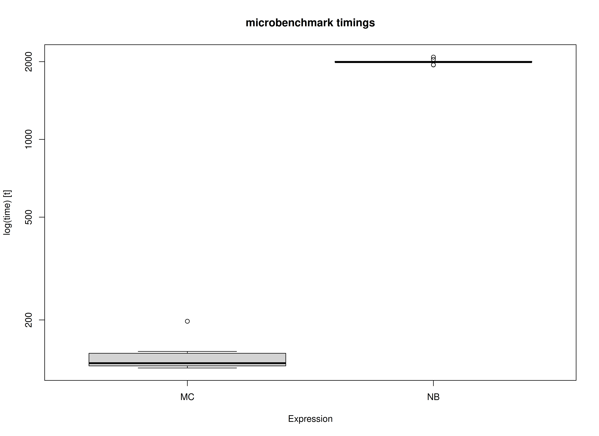

# Benchmark: Comparing the Monte Carlo Method with Nonparametric Bootstrapping

We compare the Monte Carlo (MC) method with nonparametric bootstrapping
(NB) for standardized regression coefficients. In this example, we use
the data set and the model used in [betaMC: Example Using the BetaMC
Function](https://github.com/jeksterslab/betaMC/articles/example-beta-mc.md).

\
[`library`](https://rdrr.io/r/base/library.html)`(`[`betaMC`](https://github.com/jeksterslab/betaMC)`)`\
[`library`](https://rdrr.io/r/base/library.html)`(``boot``)`\
[`library`](https://rdrr.io/r/base/library.html)`(`[`microbenchmark`](https://github.com/joshuaulrich/microbenchmark/)`)`

The
[`BetaMC()`](https://github.com/jeksterslab/betaMC/reference/BetaMC.md)
function is used to generate MC confidence intervals. The `BetaNB()`
function is used to generate NB confidence intervals.

\
`BetaNB`` ``<-`` ``function``(``formula``, ``data``, ``B``)`` ``{`\
`  ``statistic`` ``<-`` ``function``(``formula``, ``data``, ``indices``)`` ``{`\
`    `[`return`](https://rdrr.io/r/base/function.html)`(`\
`      `[`coef`](https://rdrr.io/r/stats/coef.html)`(`[`lm`](https://rdrr.io/r/stats/lm.html)`(``formula ``=`` ``formula``, data ``=`` `[`as.data.frame`](https://rdrr.io/r/base/as.data.frame.html)`(`[`scale`](https://rdrr.io/r/base/scale.html)`(``data``[``indices``, ``]``)``)``)``)``[``-``1``]`\
`    ``)`\
`  ``}`\
`  `[`return`](https://rdrr.io/r/base/function.html)`(`[`boot.ci`](https://rdrr.io/pkg/boot/man/boot.ci.html)`(`[`boot`](https://rdrr.io/pkg/boot/man/boot.html)`(``data ``=`` ``data``, statistic ``=`` ``statistic``, formula ``=`` ``formula``, R ``=`` ``B``)``)``)`\
`}`

## Data and Model

\
`df`` ``<-`` ``betaMC``::`[`nas1982`](https://github.com/jeksterslab/betaMC/reference/nas1982.md)

## Benchmark

### Arguments

| Variables | Values | Notes                               |
|:----------|:-------|:------------------------------------|
| R         | 5000   | Number of Monte Carlo replications. |
| B         | 5000   | Number of bootstrap samples.        |

\
`benchmark`` ``<-`` `[`microbenchmark`](https://rdrr.io/pkg/microbenchmark/man/microbenchmark.html)`(`\
`  MC ``=`` ``{`\
`    ``formula`` ``<-`` ``"QUALITY ~ NARTIC + PCTGRT + PCTSUPP"`\
`    ``object`` ``<-`` `[`lm`](https://rdrr.io/r/stats/lm.html)`(``formula ``=`` ``formula``, data ``=`` ``df``)`\
`    ``mc`` ``<-`` `[`MC`](https://github.com/jeksterslab/betaMC/reference/MC.md)`(``object ``=`` ``object``, R ``=`` ``R``, type ``=`` ``"mvn"``)`\
`    `[`BetaMC`](https://github.com/jeksterslab/betaMC/reference/BetaMC.md)`(``object ``=`` ``mc``)`\
`  ``}``,`\
`  NB ``=`` ``{`\
`    ``formula`` ``<-`` ``"QUALITY ~ NARTIC + PCTGRT + PCTSUPP"`\
`    ``object`` ``<-`` `[`lm`](https://rdrr.io/r/stats/lm.html)`(``formula ``=`` ``formula``, data ``=`` ``df``)`\
`    ``BetaNB``(``formula ``=`` ``formula``, data ``=`` ``df``, B ``=`` ``B``)`\
`  ``}``,`\
`  times ``=`` ``10`\
`)`

### Summary of Benchmark Results

\
[`summary`](https://rdrr.io/r/base/summary.html)`(``benchmark``, unit ``=`` ``"ms"``)`\
`#>   expr       min        lq      mean    median        uq       max neval`\
`#> 1   MC  130.3209  132.7563  143.9032  136.0322  148.5551  197.6327    10`\
`#> 2   NB 1942.4123 1989.1538 1997.7643 1991.6935 2006.3171 2082.5190    10`

### Summary of Benchmark Results Relative to the Faster Method

\
[`summary`](https://rdrr.io/r/base/summary.html)`(``benchmark``, unit ``=`` ``"relative"``)`\
`#>   expr      min      lq    mean   median       uq      max neval`\
`#> 1   MC  1.00000  1.0000  1.0000  1.00000  1.00000  1.00000    10`\
`#> 2   NB 14.90484 14.9835 13.8827 14.64134 13.50554 10.53732    10`

## Plot

