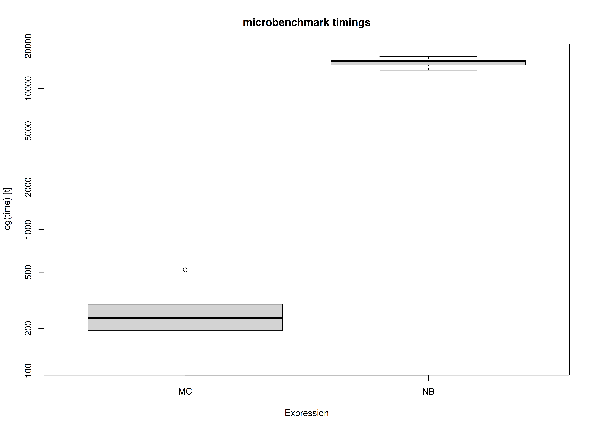

# Benchmark: Comparing the Monte Carlo Method with Nonparametric Bootstrapping

We compare the Monte Carlo (MC) method with nonparametric bootstrapping
(NB) for standardized regression coefficients. In this example, we use
the data set and the model used in [betaMC: Example Using the BetaMC
Function](https://jeksterslab.github.io/betaMC/articles/example-beta-mc.md).

\
[`library`](https://rdrr.io/r/base/library.html)`(``package ``=`` ``betaMC``)`\
[`library`](https://rdrr.io/r/base/library.html)`(``package ``=`` ``boot``)`\
[`library`](https://rdrr.io/r/base/library.html)`(``package ``=`` ``microbenchmark``)`

The
[`BetaMC()`](https://jeksterslab.github.io/betaMC/reference/BetaMC.md)
function is used to generate MC confidence intervals. The `BetaNB()`
function is used to generate NB confidence intervals.

\
`BetaNB`` ``<-`` ``function``(``formula``, ``data``, ``B``)`` ``{`\
`  ``statistic`` ``<-`` ``function``(``formula``, ``data``, ``indices``)`` ``{`\
`    ``stats``::`[`coef`](https://rdrr.io/r/stats/coef.html)`(``object ``=`` ``stats``::`[`lm`](https://rdrr.io/r/stats/lm.html)`(``formula ``=`` ``formula``, data ``=`` `[`as.data.frame`](https://rdrr.io/r/base/as.data.frame.html)`(``x ``=`` `[`scale`](https://rdrr.io/r/base/scale.html)`(``x ``=`` ``data``[``indices``, ``]``)``)``)``)``[``-``1``]`\
`  ``}`\
`  `[`boot.ci`](https://rdrr.io/pkg/boot/man/boot.ci.html)`(`[`boot`](https://rdrr.io/pkg/boot/man/boot.html)`(``data ``=`` ``data``, statistic ``=`` ``statistic``, formula ``=`` ``formula``, R ``=`` ``B``)``)`\
`}`

## Data and Model

\
`df`` ``<-`` ``betaMC``::`[`nas1982`](https://jeksterslab.github.io/betaMC/reference/nas1982.md)

## Benchmark

### Arguments

| Variables | Values | Notes                               |
|:----------|:-------|:------------------------------------|
| R         | 5000   | Number of Monte Carlo replications. |
| B         | 5000   | Number of bootstrap samples.        |

\
`benchmark`` ``<-`` `[`microbenchmark`](https://rdrr.io/pkg/microbenchmark/man/microbenchmark.html)`(`\
`  MC ``=`` ``{`\
`    ``formula`` ``<-`` ``"QUALITY ~ NARTIC + PCTGRT + PCTSUPP"`\
`    ``object`` ``<-`` ``stats``::`[`lm`](https://rdrr.io/r/stats/lm.html)`(``formula ``=`` ``formula``, data ``=`` ``df``)`\
`    ``mc`` ``<-`` `[`MC`](https://jeksterslab.github.io/betaMC/reference/MC.md)`(``object ``=`` ``object``, R ``=`` ``R``, type ``=`` ``"mvn"``)`\
`    `[`BetaMC`](https://jeksterslab.github.io/betaMC/reference/BetaMC.md)`(``object ``=`` ``mc``)`\
`  ``}``,`\
`  NB ``=`` ``{`\
`    ``formula`` ``<-`` ``"QUALITY ~ NARTIC + PCTGRT + PCTSUPP"`\
`    ``object`` ``<-`` ``stats``::`[`lm`](https://rdrr.io/r/stats/lm.html)`(``formula ``=`` ``formula``, data ``=`` ``df``)`\
`    ``BetaNB``(``formula ``=`` ``formula``, data ``=`` ``df``, B ``=`` ``B``)`\
`  ``}``,`\
`  times ``=`` ``10`\
`)`

### Summary of Benchmark Results

\
[`summary`](https://rdrr.io/r/base/summary.html)`(``object ``=`` ``benchmark``, unit ``=`` ``"ms"``)`\
`#>   expr       min         lq       mean     median         uq        max neval`\
`#> 1   MC   113.782   192.2471   257.6922   237.5266   296.3597   519.4266    10`\
`#> 2   NB 13497.578 14688.9488 15322.6810 15549.5486 15788.0079 16909.4246    10`

### Summary of Benchmark Results Relative to the Faster Method

\
[`summary`](https://rdrr.io/r/base/summary.html)`(``object ``=`` ``benchmark``, unit ``=`` ``"relative"``)`\
`#>   expr      min       lq     mean   median       uq      max neval`\
`#> 1   MC   1.0000  1.00000  1.00000  1.00000  1.00000  1.00000    10`\
`#> 2   NB 118.6267 76.40659 59.46117 65.46444 53.27312 32.55402    10`

## Plot

