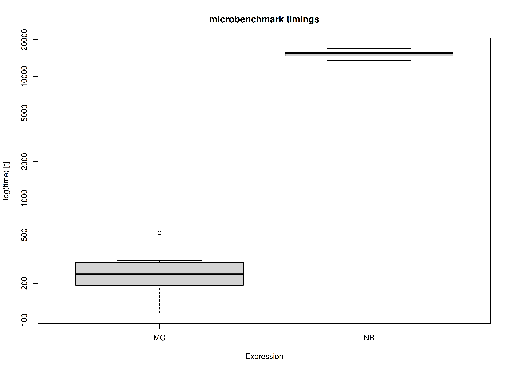

We compare the Monte Carlo (MC) method with nonparametric bootstrapping (NB)
for standardized regression coefficients.
In this example,
we use the data set and the model used in
[betaMC: Example Using the BetaMC Function](example-beta-mc.html).


``` r
library(package = betaMC)
library(package = boot)
library(package = microbenchmark)
```

The `BetaMC()` function is used to generate MC confidence intervals.
The `BetaNB()` function is used to generate NB confidence intervals.


``` r
BetaNB <- function(formula, data, B) {
  statistic <- function(formula, data, indices) {
    stats::coef(object = stats::lm(formula = formula, data = as.data.frame(x = scale(x = data[indices, ]))))[-1]
  }
  boot.ci(boot(data = data, statistic = statistic, formula = formula, R = B))
}
```

## Data and Model


``` r
df <- betaMC::nas1982
```

## Benchmark

### Arguments


|Variables |Values |Notes                               |
|:---------|:------|:-----------------------------------|
|R         |5000   |Number of Monte Carlo replications. |
|B         |5000   |Number of bootstrap samples.        |


``` r
benchmark <- microbenchmark(
  MC = {
    formula <- "QUALITY ~ NARTIC + PCTGRT + PCTSUPP"
    object <- stats::lm(formula = formula, data = df)
    mc <- MC(object = object, R = R, type = "mvn")
    BetaMC(object = mc)
  },
  NB = {
    formula <- "QUALITY ~ NARTIC + PCTGRT + PCTSUPP"
    object <- stats::lm(formula = formula, data = df)
    BetaNB(formula = formula, data = df, B = B)
  },
  times = 10
)
```

### Summary of Benchmark Results


``` r
summary(object = benchmark, unit = "ms")
#>   expr       min         lq       mean     median         uq        max neval
#> 1   MC   113.782   192.2471   257.6922   237.5266   296.3597   519.4266    10
#> 2   NB 13497.578 14688.9488 15322.6810 15549.5486 15788.0079 16909.4246    10
```

### Summary of Benchmark Results Relative to the Faster Method


``` r
summary(object = benchmark, unit = "relative")
#>   expr      min       lq     mean   median       uq      max neval
#> 1   MC   1.0000  1.00000  1.00000  1.00000  1.00000  1.00000    10
#> 2   NB 118.6267 76.40659 59.46117 65.46444 53.27312 32.55402    10
```

## Plot


